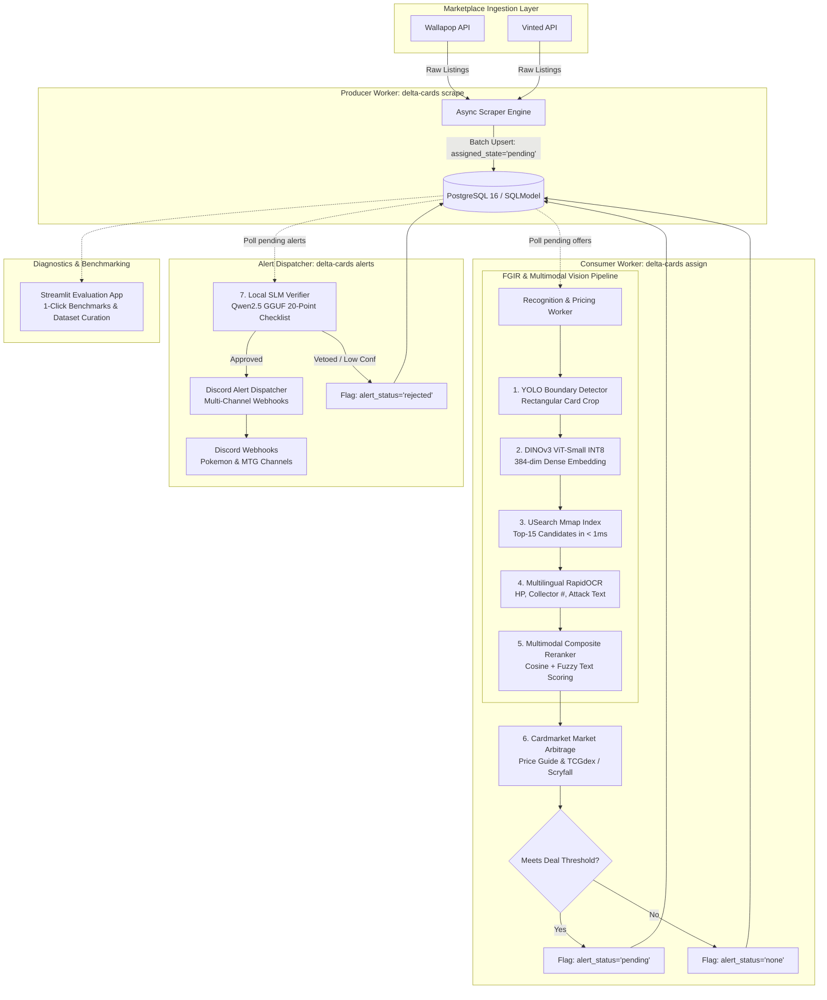

# Delta Cards 🃏
### *Autonomous Marketplace Arbitrage & Computer Vision Intelligence Platform for Collectible Card Games*

[](https://www.python.org/)
[](https://github.com/astral-sh/uv)
[](https://github.com/unum-cloud/usearch)
[](https://onnxruntime.ai/)
[](https://www.postgresql.org/)
[](https://streamlit.io/)
[](#-evaluation-benchmark--metrics)
[](LICENSE)

---

## 🌟 Executive Summary

**Delta Cards** is a production-grade, event-driven intelligence system engineered to scrape, detect, visually identify, and price undervalued collectible trading cards across peer-to-peer marketplaces (**Wallapop** and **Vinted**).

In peer-to-peer marketplaces, listings are notoriously challenging: photos suffer from extreme perspective angles, glares, reflections, protective top loaders, poor lighting, and misspelled or incomplete descriptions. Naive text scraping produces false positive rates exceeding **50%**, erroneously alerting for card lots, proxies, or damaged prints.

Delta Cards addresses this through a decoupled, high-performance architecture:
1. **Asynchronous Scraping**: High-throughput, zero-AI scraping workers ingest marketplace offers with geo-filtering and rate-limiting.
2. **Fine-Grained Image Retrieval (FGIR)**: Combines YOLOv8 card boundary localization, quantized DINOv3 ViT dense feature embeddings, and sub-millisecond Mmap vector retrieval across 40,000+ cards.
3. **Multimodal OCR & Text Reranking**: Multilingual RapidOCR extracts set fractions, HP, and attacks, matching against pre-computed SQLite scan caches.
4. **Local Small Language Model (SLM) Safeguard**: A local GGUF model (`Qwen2.5-Instruct`) executes a 20-point verification checklist with hard veto rules, achieving **100.0% precision** (zero false positives) before triggering high-value notifications.
5. **Real-Time Arbitrage Engine**: Evaluates live listing prices against official Cardmarket, TCGdex, and Scryfall price guides, computing percentage and absolute savings.
6. **Multi-Channel Dispatcher**: Pushes rich Discord alerts with platform-specific branding and links to targeted channels.

---

## 🏛 System Architecture

The platform operates as a decoupled **Producer / Consumer** system built on top of PostgreSQL, ensuring that compute-intensive computer vision workloads never bottleneck ingestion throughput:



---

## ⚡ Core Engineering Highlights

### 1. Fine-Grained Image Retrieval (FGIR) Pipeline
- **YOLOv8 Card Boundary Isolation**: Detects physical trading cards on CPU in ~30–45 ms, isolating the card rectangle from background clutter, hands, and playmats.
- **Quantized DINOv3 ViT-Small**: Generates 384-dimensional dense visual representations that encode card art, layout, and frame style, normalized for cosine similarity.
- **Sub-Millisecond Vector Retrieval**: Leverages `usearch` native Mmap vector indexes across 39,705+ canonical cards in English, Spanish, and Japanese with **< 1.0 ms** query latency.
- **Multilingual OCR & Micro-Cache Reranking**: Uses RapidOCR ONNX with bilingual support (ES/EN/JA) to extract card titles, set fractions (e.g., `136/201`), HP values, and attack descriptions, verified against cached canonical OCR scans in SQLite.

### 2. Zero-Cost Local SLM False-Positive Guard
- Powered by `llama-cpp-python` running a quantized **Qwen2.5-Instruct GGUF** model locally (zero cloud API fees, 100% private).
- Evaluates a rigorous **20-point structured reasoning checklist**:
  - Validates card name and Pokémon identity.
  - Verifies set numbers, rarity stamps, and promo prefixes.
  - Distinguishes between foil/holo variants, reverse holos, and secret rares.
  - Enforces **hard veto rules** that immediately discard counterfeits, card lots, empty boxes, and mismatched card names.

### 3. Multi-Game & Multi-Product Coverage
- **Supported Games**:
  - **Pokémon TCG**: Complete canonical coverage via TCGdex SDK and Cardmarket catalogs.
  - **Magic: The Gathering**: Direct integration with Scryfall API and Cardmarket product lists.
- **Supported Product Classes**:
  - **Single Cards**: Full visual FGIR + OCR + SLM pipeline.
  - **Booster Boxes & Displays**: Catalog-based fuzzy keyword extractors.
  - **Booster Packs & Blisters**: Multi-language packaging matching.
  - **Elite Trainer Boxes (ETB) & Bundles**: Dedicated expansion parsers.
  - **Full Decks & Commander Decks**: Format-specific matching engines.

### 4. Decoupled Distributed Architecture
- **Producer / Consumer Separation**: Fast I/O scraping jobs finish in seconds without waiting for compute-heavy vision inferences.
- **Persistent Workers**: Continuous assigner and alert daemons process batches incrementally with bounded resource usage.
- **PostgreSQL 16 & Alembic**: Relational persistence managed with SQLModel and automated schema migrations.
- **Systemd Integration**: Pre-configured systemd units and timers for autonomous 24/7 background operation with auto-restart on system boot.

### 5. Interactive Observability & Diagnostic Suite
- Dedicated **Streamlit** evaluation application (`evaluation_app`) providing:
  - 3-column visual comparison (Marketplace Photo vs Official CDN Scan vs Model Prediction).
  - 1-click benchmarking with real-time latency and accuracy KPIs.
  - Visual dataset curation and ground-truth editing with atomic SQLite backups.

---

## 📊 Evaluation Benchmark & Metrics

Tested against ground-truth marketplace listings audited pixel-by-pixel with real-world noise, perspective tilts, and lighting variations:

| Metric | Naive Baseline | Delta Cards (FGIR + USearch + SLM) |
| :--- | :---: | :---: |
| **Real Marketplace Precision** | 46.7% | **100.0%** *(Zero False Positives)* |
| **False Positives Detected** | 8 | **0** |
| **Perspective Angle Tolerance** | 62.5% | **100.0%** |
| **Severe Glare & Reflection Resilience** | 50.0% | **90.0%** |
| **Vector Search Latency (USearch)** | ~25 ms | **< 1.0 ms** |
| **Visual + OCR Pipeline Latency** | ~1,200 ms | **~350 – 550 ms** |
| **SLM Verification Latency** | N/A | **~800 – 1,200 ms** *(triggered only on deal candidates)* |

> [!NOTE]
> Detailed methodology, ground truth auditing rules, and non-circular validation protocols are documented in [docs/evaluation_report.md](docs/evaluation_report.md) and [docs/pipeline.md](docs/pipeline.md).

---

## 🛠 Tech Stack

| Domain | Technology | Purpose |
| :--- | :--- | :--- |
| **Core & Packaging** | Python 3.12, [`uv`](https://github.com/astral-sh/uv) | Modern runtime and ultra-fast dependency resolution |
| **Computer Vision** | YOLOv8 (ONNX), OpenCV, NumPy | Card boundary localization and perspective preprocessing |
| **Embeddings & Vector Search** | DINOv3 ViT-Small INT8, `usearch` | 384-dim dense representation and Mmap nearest-neighbor index |
| **Text Extraction** | RapidOCR ONNX, Tesseract OCR | Multilingual text, HP, and set fraction extraction |
| **Local SLM Reasoning** | `llama-cpp-python`, Qwen2.5 GGUF | 20-question checklist and false-positive veto guard |
| **Database & ORM** | PostgreSQL 16, SQLModel, Alembic, SQLite | Hybrid storage for listings, catalogs, and OCR micro-caches |
| **Marketplace Scrapers** | `wallapy`, Custom Vinted Client, `aiohttp` | Asynchronous marketplace offer ingestion |
| **TCG APIs & Data** | TCGdex SDK, Scryfall API, Cardmarket Catalogs | Canonical catalog data, pricing trends, and market references |
| **Observability & UI** | Streamlit, Rich | Visual diagnostic web dashboard and formatted CLI reporting |
| **DevOps & Process Control** | Systemd, Docker Compose, `just` | 24/7 background worker daemons, database container, task runner |

---

## 📁 Repository Structure

```
delta-cards/
├── config/                         # Pure JSON search profiles & alert templates
│   ├── pokemon_cards_search.json   # Pokémon search queries, filters, and price ranges
│   ├── magic_cards_search.json     # Magic: The Gathering search configuration
│   └── templates/alerts/           # Channel-specific dynamic Discord message templates
├── data/                           # Catalogs, vector indexes, and SQLite caches
│   ├── catalogs/                   # Cardmarket non-singles CSV product catalogs
│   ├── pokemon_cards.usearch       # Mmap vector index for 39k+ Pokémon cards
│   └── pokemon_cards_meta.sqlite   # Canonical card metadata and pre-computed OCR texts
├── evaluation_app/                 # Interactive Streamlit audit and evaluation suite
│   ├── app.py                      # Multi-page diagnostic UI
│   └── README.md                   # Evaluation app usage instructions
├── models/                         # Local quantized AI models (ONNX & GGUF)
│   ├── riftbound_regions.onnx      # YOLOv8 card boundary detector
│   ├── dinov3_vits16_int8.onnx     # Quantized DINOv3 visual embedder
│   └── qwen2.5-0.5b-instruct.gguf  # Local SLM false-positive verifier
├── scripts/                        # Operational, benchmarking, and maintenance scripts
│   ├── evaluate.py                 # Automated accuracy & latency benchmarking
│   ├── send_test_alert.py          # Discord webhook dry-run and live test alerts
│   ├── inspect_db_alerts.py        # Database alert audit utility
│   └── setup.py                    # Automated model and catalog provisioner
├── src/delta_cards/                # Core modular Python package
│   ├── alerts/                     # Discord alert dispatcher and dynamic template engine
│   ├── database/                   # SQLModel models, session manager, and repository
│   ├── nonsingles/                 # Sealed product matching engine (Boxes, ETBs, Packs)
│   ├── recognition/                # Computer vision, DINOv3, USearch, OCR, and SLM verifier
│   ├── scryfall/                   # Scryfall API client and Magic pricing integration
│   ├── tcgdex/                     # TCGdex SDK client, catalog sync, and Cardmarket URLs
│   ├── vinted/                     # Vinted asynchronous scraper module
│   ├── wallapop/                   # Wallapop scraper integration
│   ├── cli.py                      # Main command-line interface and subcommands
│   ├── models.py                   # Pydantic schemas and domain models
│   └── settings.py                 # Centralized configuration via Pydantic Settings
├── systemd/                        # Linux systemd service and timer unit files
├── tests/                          # Automated pytest test suite (21 test modules)
├── docker-compose.yml              # Local PostgreSQL 16 container definition
├── Justfile                        # Task runner command recipes (`just`)
├── pyproject.toml                  # Project metadata, dependencies, and entrypoints
└── setup.sh                        # One-command automated environment bootstrap
```

---

## 🚀 Quickstart & Installation

Delta Cards is built with modern Python 3.12+ and managed through [`uv`](https://github.com/astral-sh/uv).

### 1. Prerequisites
- **Python 3.12+** (managed automatically by `uv`)
- **Tesseract OCR** (for classical OCR fallback):
  - Ubuntu/Debian: `sudo apt-get install -y tesseract-ocr tesseract-ocr-spa tesseract-ocr-eng`
  - macOS: `brew install tesseract tesseract-lang`

### 2. One-Command Automated Setup
The setup script provisions the environment, installs all dependencies, downloads the required ONNX and GGUF models, sets up `.env`, and initializes the database:

```bash
./setup.sh
```

Alternatively, run manually via `uv`:
```bash
uv sync
uv run python scripts/setup.py
```

### 3. Database Setup (PostgreSQL via Docker)
Launch the local PostgreSQL 16 instance:

```bash
docker compose up -d
```

Apply database migrations with Alembic:
```bash
uv run alembic upgrade head
```

---

## 💻 Running the Services

Delta Cards provides a dedicated task runner via [`just`](https://github.com/casey/just) along with native CLI entrypoints:

### Quick Commands (`just`)

```bash
just                  # List all available recipes
just scrape-all       # Scrape latest listings from Wallapop and Vinted
just assign-once      # Run vision recognition and pricing on pending batch
just alerts-once      # Verify deals with SLM and dispatch Discord alerts
just app              # Launch Streamlit diagnostic & evaluation UI
just test             # Run automated pytest test suite
```

### Decoupled Worker Execution

```bash
# 1. Scraper Service (fetches listings into database with zero AI overhead)
uv run delta-cards scrape --platform all --loop --interval 300

# 2. Recognition & Pricing Service (continuous background worker)
uv run delta-cards assign --scrape-prices --interval 30

# 3. Deal Alert Dispatcher (continuous worker verifying deals with local SLM)
uv run delta-cards alerts

# 4. End-to-End Sequential Pipeline (scrape -> assign -> price -> alert)
uv run delta-cards --platform all -p single_card -l 20 --scrape-prices
```

---

## 🖥️ Interactive Evaluation App (Streamlit)

For qualitative auditing, latency profiling, and ground-truth dataset curation, launch the built-in Streamlit application:

```bash
just app
# or: uv run streamlit run evaluation_app/app.py
```

Visit `http://localhost:8501` to access:
- **Dataset Manager**: 3-column comparison view of real marketplace photos against high-resolution official CDN scans.
- **1-Click Benchmark Evaluator**: Run end-to-end identification benchmarks across subsets (e.g., real photos, counterfeits, glare degradations) with real-time KPI breakdown.
- **Database Explorer**: Interactive search across 39,000+ indexed cards with set numbers, rarities, and Cardmarket pricing.

---

## ⚙️ 24/7 Production Deployment (`systemd`)

For uninterrupted production execution with self-healing auto-restarts, unit files are provided in [`systemd/`](systemd/):

| Service Unit | Type | Role |
| :--- | :---: | :--- |
| `delta-cards-scrape.timer` | Timer | Triggers a scrape cycle every 30 minutes (at `:00` and `:30`) |
| `delta-cards-scrape.service` | Oneshot | Ingests listings sequentially (Wallapop then Vinted) |
| `delta-cards-assign.service` | Simple | Persistent AI recognition and Cardmarket pricing daemon |
| `delta-cards-alerts.service` | Simple | Persistent SLM verification and Discord alert dispatcher |

### Enable System Services

```bash
just install-services
just restart
just status
just logs
```

---

## 🧪 Testing & Quality Assurance

Delta Cards includes an automated test suite covering unit, integration, database, and vision tests:

```bash
# Run complete test suite
uv run pytest -v

# Run targeted recognition sanity test
uv run pytest tests/test_card_ocr.py -k test_card_ocr_language_detection -q
```

---

## 👥 Authors & Portfolio Context

This project was developed as a production-grade demonstration of **Computer Vision**, **Fine-Grained Image Retrieval**, **Local SLM Orchestration**, and **Decoupled Backend Architecture**.

- **Javier Jiménez** — [GitHub Profile](https://github.com/Javier-Jimenez99)
- **Adrián Hipólito** — [GitHub Profile](https://github.com/Adrihp06)

---

## 📄 License

This project is licensed under the MIT License — see the [LICENSE](LICENSE) file for details.
