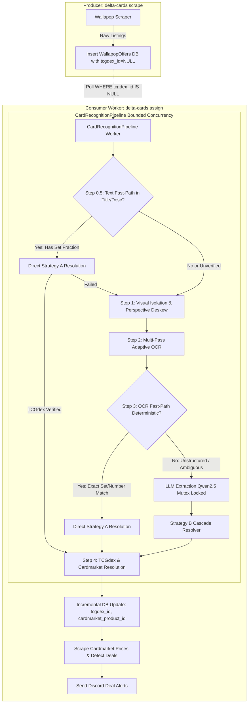

# Delta Cards 🃏 Card Recognition & Assignment Pipeline

This document provides a comprehensive technical breakdown of how Delta Cards processes, recognizes, and enriches Pokémon card offers from Wallapop with official **TCGdex IDs** and **Cardmarket Product IDs**, as well as how concurrency and performance optimizations are achieved safely without CPU thrashing or memory corruption.

---

## 🏛 High-Level Architecture Overview

Delta Cards follows a decoupled Producer/Consumer architecture designed for high accuracy, zero false positives, and maximum throughput:

- **Producer (`delta-cards scrape`)**: Rapidly fetches listing offers from Wallapop and writes them to the `WallapopOffers` database table (`tcgdex_id = NULL`). Runs purely with I/O and zero AI overhead, finishing in seconds.
- **Consumer (`delta-cards assign`)**: Always-on persistent background worker. Asynchronously and continuously monitors `WallapopOffers` for new unassigned single cards, passes them through `CardRecognitionPipeline`, matches TCGdex & Cardmarket IDs, queries Cardmarket prices, and sends Discord alerts.
- **Workflow**:
  - **Assigner Service (Always On)**: `uv run delta-cards assign --scrape-prices`
  - **Scraper (Triggered on demand or via cron)**: `uv run delta-cards scrape -p single_card`



---

## 🔍 Detailed Pipeline Steps

### Step 0: Caller-Level Database Deduplication (`src/delta_cards/cli.py`)

Before any image downloading or AI model computation occurs:
1. **Single Card Isolation**: Filters listings strictly matching single card criteria (`is_card_offer`), ignoring sealed booster boxes, packs, or lots.
2. **Database Verification**: Queries the `WallapopOffers` table in chunks of 500 IDs using SQLModel/SQLAlchemy.
3. **Zero Redundant Work**:
   - If an offer was already processed in a previous scrape (whether it successfully matched a card or was an unmatchable custom lot), its existing IDs are restored and it **completely bypasses the assignment pipeline**.
   - Only genuinely new, unassigned card offers proceed to `CardRecognitionPipeline`.

---

### Step 1: Visual Card Isolation & Perspective Deskew (`src/delta_cards/recognition/visual_detector.py`)

Marketplace photos are often taken at awkward angles, with clutter or hands holding the card.

1. **Dual-Mode Detection**:
   - **Primary**: ONNX YOLOv8 card detector (`onnx/best.onnx`) running on CPU using ONNX Runtime.
   - **Fallback**: Classical computer vision using edge detection (`cv2.Canny`), morphological dilation, and quadrilateral contour scoring.
2. **Perspective Transform**:
   - Detects the 4 corner points of the physical card.
   - Orders the corners: `[top-left, top-right, bottom-right, bottom-left]`.
   - Computes transformation matrix `cv2.getPerspectiveTransform` and applies `cv2.warpPerspective` to generate an upright, deskewed, cropped image of the card (standardized to 600×840px).
3. **Graceful Fallback**:
   - If card boundaries cannot be detected with sufficient confidence (e.g. poor lighting, extreme crop), the detector proceeds with OCR on the full uncropped photo rather than failing.

---

### Step 2: Multi-Pass Adaptive OCR (`src/delta_cards/recognition/ocr_engine.py`)

Extracts text from the physical card surface (name, HP, attack names, collector numbers, copyright line).

1. **Image Preprocessing**:
   - Grayscale conversion.
   - **CLAHE** (Contrast Limited Adaptive Histogram Equalization) to balance uneven lighting and glare on holographic surfaces.
   - Bilateral filtering to preserve card edges while eliminating surface noise.
   - Otsu automated thresholding for high-contrast binarization.
2. **Bilingual OCR Engine**:
   - Uses Tesseract with Spanish and English trained models (`spa+eng`).
   - Runs two page segmentation modes (PSM):
     - **PSM 3** (Fully automatic page segmentation) for full card context.
     - **PSM 11** (Sparse text with OSD) to capture isolated corner numbers and set symbols.
3. **Token Normalization**: Cleans OCR noise, strips special punctuation, and normalizes numeric fractions (e.g. `057 / 191` $\rightarrow$ `057/191`).

---

### Step 3: Hybrid Entity Extraction (`src/delta_cards/recognition/entity_parser.py`)

Raw OCR text and marketplace descriptions are synthesized into normalized metadata:
- `card_name`: Normalized Pokémon / Trainer name.
- `set_code`: Official set code (e.g. `sv08`, `base1`, `swsh4`).
- `collector_number`: Exact card number within set (e.g. `057/191`, `4/102`).
- `language`: Physical card language (`es`, `en`, `ja`, etc.).

#### A. Fast-Path: Strict Deterministic Extraction (~1ms)
- 70–80% of legitimate card listings include standard collector fractions (`num/den` like `057/191`, `11/102`) or promo codes (`SVP 159`, `SWSH 123`).
- Validates the denominator against `STRICT_DENOMINATOR_SET_MAP` (a curated map of official Pokémon set sizes).
- Validates that the numerator is logically sound ($1 \le \text{num} \le \text{den} + 50$).
- Cleans the card name using regex to strip marketplace adjectives (e.g., "Carta Pokémon", "Impecable", "Ultra Rara").
- **Speed**: Executes in $\approx 1\,\text{ms}$, completely skipping LLM invocation.

#### B. Fallback Path: Local Quantized LLM (`Qwen2.5-0.5B-Instruct-GGUF`)
- If the listing has ambiguous text, typos, or missing fractions, it invokes the local CPU LLM.
- **Pydantic Grammar Constraint**: Uses `llama-cpp-python` with `response_format={"type": "json_object", "schema": schema}` to enforce valid JSON schema generation.
- **Physical Card Language Detection**: Uses `langdetect` on card OCR tokens + HP/PS markers (e.g., `PS` $\rightarrow$ Spanish, `HP` $\rightarrow$ English, `KP` $\rightarrow$ German) to determine the language of the *card itself*, ignoring seller description prose.

---

### Step 4: TCGdex Live Resolver (`src/delta_cards/recognition/tcgdex_resolver.py`)

Maps extracted metadata to official TCGdex card data and Cardmarket product identifiers.

1. **Strategy A (Direct Set & Number Lookup)**:
   - For fast-path extractions, executes direct query: `GET https://api.tcgdex.net/v2/{lang}/sets/{set_code}/{local_id}`.
   - Zero false positives: if the card name does not match the returned record, it is rejected.
2. **Strategy B (Cascaded Search)**:
   - Queries TCGdex by card name, then filters candidates by collector number, set name, and localized name.
3. **Cardmarket Enrichment**:
   - Resolves `cardmarket_product_id` and canonical URL (`https://www.cardmarket.com/es/Pokemon/Products/Singles/...`).
   - Retrieves live lowest market price (`cardmarket_low_price`).

---

### Step 5: Incremental Database Persistence (`src/delta_cards/database/repository.py`)

- As each card finishes processing, `WallapopOffers` is updated immediately with `tcgdex_id`, `cardmarket_product_id`, `language`, and `cardmarket_low_price`.
- If the user interrupts execution (Ctrl+C), all progress made up to that card is safely preserved in SQLite/PostgreSQL.

---

## ⚡ Concurrency, Parallelism & Speedup Architecture

### The Problem: Why Naive Multithreading Crashed
Earlier attempts at running `pipeline.py` with multi-threading encountered crashes:
- `llama-cpp-python`'s underlying C++ engine (`libggml-cpu.so.0`) maintains internal KV caches and computation graphs that are **not thread-safe**.
- When multiple Python threads called `create_chat_completion` concurrently, threads simultaneously modified the internal KV cache buffers, causing out-of-bounds indexing and segmentation faults (`SIGSEGV / exit code 139`).

### The Solution: Asynchronous Bounded Concurrency + Thread-Safe LLM Serialization

Delta Cards employs an asynchronous bounded concurrency model combining `asyncio` and thread-safe mutex locking:

| Pipeline Phase | Execution Mechanism | Concurrency Model |
| :--- | :--- | :--- |
| **Image Downloading** | Async HTTP (`httpx`) | **Full Parallelism** (up to 4 concurrent network requests) |
| **Visual Detection & Deskew** | CPU Thread (`asyncio.to_thread`) | **Full Parallelism** (multithreaded OpenCV / ONNX) |
| **OCR Text Extraction** | CPU Thread (`asyncio.to_thread`) | **Full Parallelism** (concurrent Tesseract processes) |
| **Deterministic Fast-Path** | In-memory regex evaluation | **Instant** (~1ms per card, parallel) |
| **LLM Fallback Extraction** | CPU Thread + `threading.Lock` | **Serialized Mutex** (safely queues to prevent memory corruption) |
| **TCGDex API Resolution** | Async HTTP (`httpx`) | **Full Parallelism** (concurrent API lookups) |
| **Database Persistence** | Transactional commit | **Thread-Safe Incremental Updates** |

### Key Concurrency Components

1. **`asyncio.Semaphore(max_concurrency=4)`**:
   - Limits active card pipelines to 4 simultaneous workers.
   - Prevents network exhaustion and keeps CPU utilization balanced.
2. **Thread-Safe LLM Mutex (`self._llm_lock = threading.Lock()`)**:
   - Inside `EntityParser.parse_listing`, the LLM execution is guarded:
     ```python
     with self._llm_lock:
         response = self.llm.create_chat_completion(...)
     ```
   - While OCR, image downloading, and API resolutions happen concurrently for 4 cards at once, any LLM fallback calls are cleanly serialized. This eliminates C++ memory corruption while maintaining maximum system throughput.
3. **Safe C++ Context Recovery**:
   - If an unexpected error occurs during LLM extraction, the `Llama` C++ context is automatically reconstructed to clear any dirty state before the lock is released.
4. **Fast-Path Bypass**:
   - Because 70–80% of cards resolve through the deterministic fast-path, the LLM mutex is rarely contended, allowing the majority of cards to finish in fractions of a second.

---

## 📊 Summary Performance Characteristics

- **Deterministic Cards**: ~0.2 – 0.5 seconds per card (including image download, OCR, and TCGdex verification).
- **Ambiguous Cards (LLM Fallback)**: ~1.5 – 3.0 seconds per card (Qwen2.5-0.5B CPU inference).
- **Already Scraped Cards**: 0.0 seconds (bypassed at database query level).
